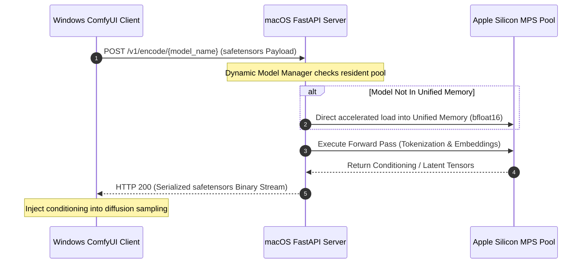

# ComfyUI-MacOffload-TE ⚡

> **High-Performance Cross-Platform Text Encoder Offloading for ComfyUI**  
> Offload heavy Text Encoders (Flux.2 Klein, Flux.3 Klein, Qwen-Image-2.1) from your VRAM-constrained GPU (e.g. RTX 4060 8GB) to a macOS machine with Apple Silicon Unified Memory (MPS) over your local network — eliminating model swapping, boosting generation speed, and unlocking higher native image resolutions.

---

## 1. Overview & Motivation

When running state-of-the-art diffusion pipelines (such as Flux Klein or Qwen Image) on consumer GPUs with 8GB VRAM (such as RTX 4060 8GB), the text encoder often occupies 8GB to 18GB of memory. On single-GPU setups, this forces ComfyUI into continuous, aggressive model swapping (VRAM thrashing between GPU and system RAM over PCIe), causing steep performance degradation, sluggish iteration cycles, and frequent out-of-memory (OOM) crashes.

**ComfyUI-MacOffload-TE** eliminates this bottleneck by offloading heavy text encoders to a remote macOS device (such as a MacBook, Mac mini, or Mac Studio) equipped with Apple Silicon Unified Memory:

- **0 MB Local VRAM Footprint**: The entire text encoder runs remotely on Apple Silicon MPS, completely freeing your local GPU from text encoder memory overhead.
- **Faster Generation & Higher Efficiency**: Completely bypasses the sluggish PCIe model swapping phase between text encoding and diffusion sampling. The local GPU stays primed with diffusion weights, launching sampling immediately and dramatically accelerating generation throughput.
- **Higher Direct Output Resolutions**: Reclaiming precious VRAM headroom allows the local GPU to allocate maximum memory to the diffusion transformer (DiT) and VAE, enabling direct generation at substantially higher native image resolutions and larger latent dimensions without OOM errors.
- **Dual-Device Synergy**:
  - **Client (Windows)**: Dedicates 100% of GPU compute and VRAM to diffusion backbone sampling and VAE decoding.
  - **Server (macOS / Apple Silicon)**: Keeps large text encoders resident in Unified Memory (MPS), serving tokenization and embedding forward passes over low-latency, safe safetensors streaming.

---

## 2. Architecture & Communication Flow

### Text Architecture Overview
```text
+-------------------------------------------------------------+
|                      Windows Client                         |
|  [ComfyUI]                                                  |
|   └── Custom Node (Facade + Helpers)                        |
|        ├── Read server address from local disk config       |
|        ├── Pack prompt text & optional reference images     |
|        ├── Serialize to safe, data-only safetensors stream  |
|        └── HTTP POST (application/octet-stream)             |
+------------------------------+------------------------------+
                               |
                   Local Area Network (LAN)
                   Low-latency safetensors Stream
                               |
+------------------------------v------------------------------+
|                     macOS Server (MPS)                      |
|  [FastAPI Bridge]                                           |
|   ├── Route: /v1/encode/{model_name}                        |
|   ├── Parse safetensors payload (no pickle / no RCE risk)   |
|   ├── Dynamic Model Pool (Auto-discovery + LRU Eviction)    |
|   ├── Direct Accelerated MPS Loading (safetensors mmap)     |
|   └── Return serialized Conditioning tensors (safetensors)  |
+-------------------------------------------------------------+
```

### Flow Sequence


---

## 3. Supported Models

| Model Folder Name | DiT Model | Text Encoder Architecture | Hugging Face Repository | Summary |
| :--- | :--- | :--- | :--- | :--- |
| `flux2-klein-4b-uncensored-text-encoder` | FLUX.2 Klein (4B) | Qwen3-4B | [`ponpoke/flux2-klein-4b-uncensored-text-encoder`](https://huggingface.co/ponpoke/flux2-klein-4b-uncensored-text-encoder) | Uncensored text encoder variant for FLUX.2 Klein 4B DiT. Processed to remove refusal vectors to prevent safety filter refusals. |
| `flux2-klein-9b-uncensored-text-encoder` | FLUX.2 Klein (9B) | Qwen3-8B | [`ponpoke/flux2-klein-9b-uncensored-text-encoder`](https://huggingface.co/ponpoke/flux2-klein-9b-uncensored-text-encoder) | Uncensored text encoder variant for FLUX.2 Klein 9B DiT with higher parameter capacity for nuanced prompt comprehension without safety filter refusals. |
| `Qwen3-VL-4b-Heretic` | FLUX.3 Klein (5.6B) | Qwen3-VL-4B | [`DreamFast/Qwen3-VL-4b-Heretic`](https://huggingface.co/DreamFast/Qwen3-VL-4b-Heretic) | Abliterated version of `Qwen3-VL-4B-Instruct` processed using the Heretic optimizer to remove refusal behaviors. Eliminates safety filter refusals while preserving underlying language comprehension and vision capabilities. |
| `Qwen-Image-2.1-Text-Encoder-Heretic` | Qwen-Image-2.1 | Qwen3-VL-8B | [`pottokao/Qwen-Image-2.1-Text-Encoder-Heretic`](https://huggingface.co/pottokao/Qwen-Image-2.1-Text-Encoder-Heretic) | Abliterated "Heretic" version of the Qwen-Image-2.1 text encoder based on the Qwen3-VL-8B architecture. Removes safety alignment refusals using directional ablation on `o_proj` and `down_proj` layers while preserving functional vision-language performance. |

---

## 4. Installation & Setup

### 4.1 Client Setup (Windows ComfyUI)

1. Clone or copy this repository into your ComfyUI `custom_nodes/` directory:
   ```bash
   cd ComfyUI/custom_nodes
   git clone <repo-url> ComfyUI-MacOffload-TE
   ```

2. Restart ComfyUI. The nodes will be available under category:
   `⚡ MacOffload/Conditioning`

3. **Configuring Mac Server Address**:
   - The Mac server address is saved locally on disk (`macoffload_config.json`) and is **never** embedded inside shared workflow files (protecting users from SSRF and untrusted redirects).
   - Configure it in two ways:
     - **In ComfyUI Settings**: Open ComfyUI Settings (⚙️ icon) and set `MacOffload: Remote macOS Server Address`.
     - **On the Node**: Click the `⚙️ Configure Mac Server` button directly on any MacOffload node.

4. **Node Controls & UI Features**:
   - **⚙️ Configure Mac Server**: Opens a dialog to view or change the remote macOS server address saved on your local machine.
   - **🔄 Fetch Models from Server**: Queries the remote Mac server using your saved address and populates the `model_name` dropdown.
   - **Saved Workflow Memory**: The node preserves selected models across workflow reloads.
   - **❓ Help Badge**: Click the `?` icon in the node title bar (or right-click the node and select **"About this node ❓"**) to view diagnostics and usage information.

---

### 4.2 Server Setup (macOS / Apple Silicon)

1. Navigate to the `server/` directory on your Mac:
   ```bash
   cd ComfyUI-MacOffload-TE/server
   ```

2. Create and activate a Python virtual environment:
   ```bash
   python3 -m venv .venv
   source .venv/bin/activate
   ```

3. Install server dependencies:
   ```bash
   pip install -r requirements.txt
   ```

4. Configure model paths:
   Copy the `.env.example` file to `.env`:
   ```bash
   cp .env.example .env
   ```
   Edit `.env` to point `MODELS_DIR` to your model directory (defaults to `~/models`):
   ```ini
   MODELS_DIR=/Users/<your-username>/models
   BRIDGE_PORT=8288
   MAX_MODELS=1
   ```

   Place your model folders inside `MODELS_DIR`:
   ```text
   ~/models/
   ├── Qwen-Image-2.1-Text-Encoder-Heretic/
   ├── Qwen3-VL-4b-Heretic/
   ├── flux2-klein-4b-uncensored-text-encoder/
   └── flux2-klein-9b-uncensored-text-encoder/
   ```

5. Launch the server:
   ```bash
   python server.py
   ```

---

## 5. Server Startup Arguments & Options

The server supports command-line arguments, `.env` file, and environment variables:

| CLI Option | Environment Variable | Default | Description |
| :--- | :--- | :--- | :--- |
| `--host` | `BRIDGE_HOST` | `0.0.0.0` | Server host IP address to bind to |
| `--port` | `BRIDGE_PORT` | `8288` | Port number to listen on |
| `--max-models` | `MAX_MODELS` | `1` | Maximum concurrent models kept in Apple Silicon Unified Memory (LRU eviction) |
| `--idle-timeout` | `IDLE_TIMEOUT` | `0` | Seconds of inactivity before auto-unloading a model (`0` = keep resident indefinitely) |
| `--models-dir` | `MODELS_DIR` | `~/models` | Root directory to scan for model folders |
| `--device` | `BRIDGE_DEVICE` | `mps` | Target inference device (`mps` on Apple Silicon, `cuda`, or `cpu`) |
| `--settling-delay` | `SETTLING_DELAY` | `1.0` | Memory settling window in seconds after model eviction before loading next model |

### Example CLI Commands:
```bash
# Run with default configuration (.env or ~/models)
python server.py

# Custom port and custom models directory
python server.py --port 8288 --models-dir /Volumes/ExternalSSD/models

# Keep at most 1 resident model with 300s idle auto-unload
python server.py --max-models 1 --idle-timeout 300
```

---

## 6. Node Reference

### 1. `Remote CLIP Text Encode (Flux Klein) ⚡`
- **Class Identifier**: `MACOFFLOAD_RemoteCLIPTextEncode`
- **Category**: `⚡ MacOffload/Conditioning`
- **Description**: Drop-in replacement for native CLIPTextEncode in Flux.2 Klein and Flux.3 Klein workflows.
- **Inputs**:
  - `model_name` *(COMBO)*: Target model folder name (e.g. `flux2-klein-4b-uncensored-text-encoder`, `Qwen3-VL-4b-Heretic`).
  - `text` *(STRING)*: Positive or negative text prompt.
- **Outputs**:
  - `conditioning` *(CONDITIONING)*: Formatted conditioning tuple containing stacked hidden states (`[batch, seq_len, 12288]` for Flux.2, `[batch, seq_len, 20480]` for Flux.3) and pooled representation.

---

### 2. `Remote Text Encode Qwen Image 2.1 ⚡`
- **Class Identifier**: `MACOFFLOAD_RemoteTextEncodeQwenImage21`
- **Category**: `⚡ MacOffload/Conditioning`
- **Description**: Multimodal text and multi-image reference encoder for Qwen-Image-2.1.
- **Inputs**:
  - `model_name` *(COMBO)*: Target model folder name (e.g. `Qwen-Image-2.1-Text-Encoder-Heretic`).
  - `prompt` *(STRING)*: Positive text prompt.
  - `negative_prompt` *(STRING)*: Negative text prompt.
  - `resolution` *(INT, default: 1024)*: Target dimension for reference image scaling (multiples of 32).
  - `vae` *(VAE, optional)*: WanVAE model used to encode reference images into reference latents.
  - `image_1` ~ `image_16` *(IMAGE, optional)*: Up to 16 input reference images.
- **Outputs**:
  - `positive` *(CONDITIONING)*: Positive conditioning with sliced hidden states and vision slots.
  - `negative` *(CONDITIONING)*: Negative conditioning.
  - `latent` *(LATENT)*: WanVAE-compatible 64-channel latent tensor `[1, 64, H//16, W//16]`.

---

## 7. Server REST API Reference

### List Available Models
- **Endpoint**: `GET /v1/models`
- **Description**: Scans `MODELS_DIR` and returns discovered model folder names, their encoder categories, and resident status.
- **Response**:
  ```json
  {
    "models": [
      "Qwen-Image-2.1-Text-Encoder-Heretic",
      "Qwen3-VL-4b-Heretic",
      "flux2-klein-4b-uncensored-text-encoder",
      "flux2-klein-9b-uncensored-text-encoder"
    ],
    "model_types": {
      "Qwen-Image-2.1-Text-Encoder-Heretic": "qwen_image",
      "Qwen3-VL-4b-Heretic": "flux3_klein",
      "flux2-klein-4b-uncensored-text-encoder": "flux_klein",
      "flux2-klein-9b-uncensored-text-encoder": "flux_klein"
    },
    "resident_models": ["Qwen3-VL-4b-Heretic"]
  }
  ```

### Health Probe
- **Endpoint**: `GET /health`
- **Response**:
  ```json
  {
    "status": "online",
    "device": "mps",
    "dtype": "torch.bfloat16",
    "max_models": 1,
    "idle_timeout": 0,
    "active_models": ["flux2-klein-4b-uncensored-text-encoder"],
    "discovered_models": [
      "flux2-klein-4b-uncensored-text-encoder",
      "flux2-klein-9b-uncensored-text-encoder",
      "Qwen-Image-2.1-Text-Encoder-Heretic"
    ]
  }
  ```

### Dynamic Encoding
- **Endpoint**: `POST /v1/encode/{model_name}`
- **Headers**: `Content-Type: application/octet-stream`
- **Body**: Non-executable safetensors binary stream containing prompt text, options, and input tensors.
- **Response**: Safetensors binary stream containing conditioning tensors and pooled representations.

### Manual Memory Eviction
- **Endpoint**: `POST /v1/unload`
- **Body (optional JSON)**:
  ```json
  {"model_name": "flux2-klein-4b-uncensored-text-encoder"}
  ```
  *(Omit `model_name` or send `{}` to evict all loaded models and flush Unified Memory).*

---

## 8. Troubleshooting & FAQ

### Q: Node fails with `Connection failed to 'http://...:8288'`
1. Check if the Mac server is running (`python server.py`).
2. Verify both machines are on the same local network subnet.
3. Verify the IP address by running `ipconfig` (Windows) and `ifconfig` or `ipconfig getifaddr en0` (macOS).
4. Check macOS Firewall (*System Settings -> Network -> Firewall*): ensure incoming connections to Python are allowed.
5. Test connectivity from Windows PowerShell:
   ```powershell
   curl http://<mac-ip>:8288/health
   ```

### Q: How does model selection work?
- The node remembers the model name from your last run or saved workflow.
- To discover new models added to your Mac server's models directory, click the **"🔄 Fetch Models from Server"** button on the node. The dropdown list will update immediately while retaining your current selection if still valid.

---

## 9. License

MIT License. Free for personal and commercial workflows.
